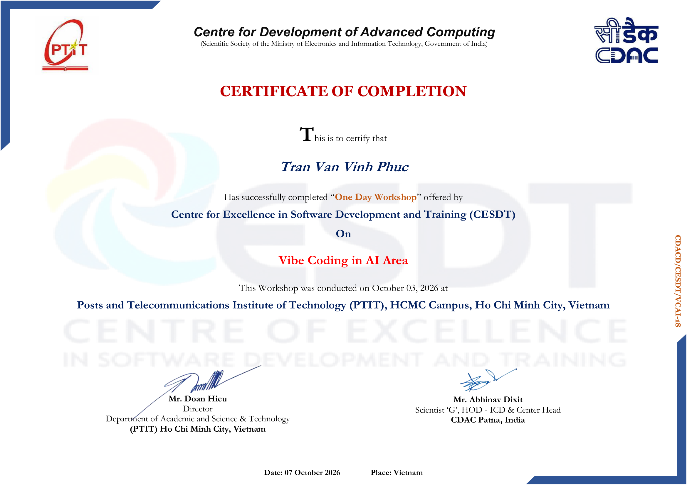

# Hi, I'm Vinh Phuc 👋

**Aspiring Software Developer · Open to internship opportunities**

Learning web development with AI-assisted workflows — and learning to understand what I build.

---

## 👨‍💻 About me

- 🎯 Seeking a **software development internship** where I can learn from a team and contribute incrementally.
- 🌱 Currently learning **JavaScript, React and TypeScript** through hands-on practice and an AI-assisted project.
- 🎬 Built **CineHub** with AI tools ("vibe coding"). I set the requirements and worked with AI; I'm now reviewing the code to understand, debug and test it — I don't present it as hand-written.
- 🛡️ Learning **cybersecurity fundamentals** on TryHackMe — module *Start Your Cyber Security Journey*.
- ➡️ Next step: build a small app from scratch without AI to strengthen my fundamentals.

## 🧰 Tools I've used while learning

## 🎬 Learning project

### [CineHub](https://github.com/VihPhuc/cinehub) — AI-assisted movie streaming SPA

CineHub is a **learning project whose application code was generated with AI tools** ("vibe coding"). I defined the requirements and worked with AI to build it; I'm now going through the codebase to understand how it works, fix issues and learn testing. I don't present it as hand-written code.

**What the app includes** (generated with AI, now being reviewed):

- Browse movies, series, anime and TV shows; search and filter by genre/country.
- Favorites, watch history and resume playback.
- HLS playback with `hls.js` and an iframe fallback for sources without `m3u8`.
- PWA with an offline app shell, API/image caching and shareable deep links.

**What I'm learning from it:**

- How URL state, API calls and caching fit together.
- How a service worker caches the app shell, API responses and images.
- How to read, debug and test a React/TypeScript codebase.
- Why input validation, sanitization, CSP and security headers matter.

## 📜 Certificates & training

<b>Certificate of Completion — Vibe Coding in AI Area</b> · CDAC CESDT × PTIT, Oct 2026

 

Completed a one-day workshop offered by the **Centre for Excellence in Software Development and Training (CESDT)**, CDAC, at **Posts and Telecommunications Institute of Technology (PTIT), HCMC Campus**, on **03 October 2026**. This workshop introduced the AI-assisted workflow I used for CineHub; my current focus is reviewing and understanding the generated code rather than treating it as hand-written.

## 🌱 Currently learning

- **JavaScript and React fundamentals**
- Reading and debugging the **CineHub** codebase
- Writing tests with **Vitest**
- **TryHackMe** — *Start Your Cyber Security Journey* ([profile](https://tryhackme.com/p/tranvanvinhphuc205))

## 🎯 2026 goals

- [ ] Land a software development internship
- [ ] Be able to explain and modify CineHub without AI
- [ ] Build one small app from scratch
- [ ] Complete the TryHackMe beginner path

## 📫 Connect

- GitHub: [@VihPhuc](https://github.com/VihPhuc)
- TryHackMe: [tranvanvinhphuc205](https://tryhackme.com/p/tranvanvinhphuc205)
- Email: <!-- TODO: add your email --> *available upon request*

---

Thanks for stopping by — always happy to learn and collaborate.

